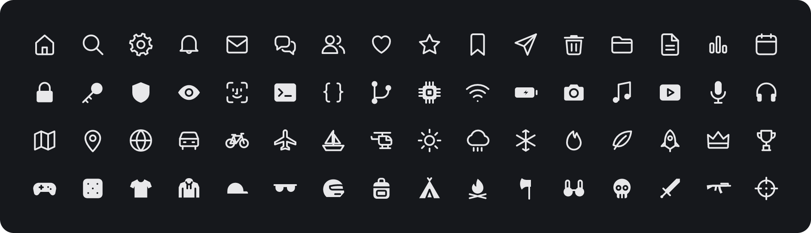

# Miralabs Icônes

[](https://www.npmjs.com/package/@miralabs-tech/icones)
[](https://www.npmjs.com/package/@miralabs-tech/icones)
[](https://github.com/miralabs-tech/miralabs-icones/actions/workflows/ci.yml)
[](https://github.com/miralabs-tech/miralabs-icones/releases)
[](https://miralabs-tech.github.io/miralabs-icones/docs/)
[](https://www.typescriptlang.org/)
[](./native/README.md)
[](./LICENSE)

> Des symboles dessinés à la main sur une grille 24, décrits une fois en couches : six graisses, contour et plein, mono et hiérarchique, pour le web et le natif.

📖 [English](./README.md) · Français

[Explorateur](https://miralabs-tech.github.io/miralabs-icones/docs/) · [Démarrage](#-démarrage) · [Collections](#-collections) · [Natif](./native/README.md) · [Contribuer](./CONTRIBUTING.md)

<p align="center"></p>

---

## 🧠 De quoi s'agit-il ?

**436 symboles en 25 collections**, tous dessinés à la main sur une grille 24 × 24 (trait 1,5 en Régulier, extrémités et jointures rondes). Les noms suivent la convention SF (`objet.modificateur`, par exemple `square.and.arrow.up`) ; aucun tracé n'est repris d'un jeu existant, aucun logo n'est inclus ([LICENSE-BRANDS](./LICENSE-BRANDS)).

Un symbole est écrit **une seule fois, en couches** ; toutes les variantes sont dérivées au rendu :

- **6 graisses** : `thin`, `light`, `regular`, `medium`, `semibold`, `bold`, alignées sur `font-weight` 200 → 700.
- **2 formes** : `outline` et `fill` (le plein est découpé dans la même source, pas redessiné).
- **2 tons** : `mono` et `hier` (hiérarchique : couches secondaires à 42 %).
- **Couleur** : toujours `currentColor` ; **taille** : un jeton (`sm`, `md`, `lg`) ou n'importe quelle longueur CSS.

Deux moteurs lisent la même IR de rendu, donc dessinent la même chose :

```
src/data.ts ──▶ IR (symbolOps) ──┬──▶ moteur web  → chaîne SVG / DOM / <mira-symbol>
 (couches)                        └──▶ moteur C99  → masque de couverture 8 bits (FFI)
```

---

## 🚀 Démarrage

```js
import { trash } from "@miralabs-tech/icones";
import { symbolToString } from "@miralabs-tech/icones/render";

el.innerHTML = symbolToString(trash, { weight: "semibold", shape: "fill", size: "md", label: "Supprimer" });
```

```html
<script type="module" src="node_modules/@miralabs-tech/icones/dist/mira-symbol.all.js"></script>
<mira-symbol name="trash" weight="semibold" shape="fill" size="md" label="Supprimer"></mira-symbol>
```

---

## 📦 Installation

```sh
bun add @miralabs-tech/icones
```

`dist/` est committé : `github:miralabs-tech/miralabs-icones#v<version>` fonctionne aussi comme dépendance, sans étape de build.

---

## ✨ Utilisation

| Cible | Point d'entrée | Notes |
| --- | --- | --- |
| Données, tree-shakées | `@miralabs-tech/icones` | un export par symbole (`squareAndArrowUp`, `_5g`) |
| Moteur (~1 kB) | `@miralabs-tech/icones/render` | `symbolToString`, `symbolToElement`, `symbolTree` |
| Web component | `@miralabs-tech/icones/mira-symbol` | `<mira-symbol>`, light DOM ; on n'enregistre que ce qu'on utilise |
| Jeu complet | `@miralabs-tech/icones/mira-symbol.all` | enregistre tous les symboles |
| Sprites SVG | `@miralabs-tech/icones/sprite/<graisse>-<forme>.svg` | zéro JS, `<use href="…#trash"/>` |
| Données brutes | `symbols.json`, `ir.json`, `metadata.json` | moteurs non-JS, recherche, outils de design |
| Frameworks | `adapters/{react,vue,svelte,angular}` | ~30 lignes chacun, aucun SVG dupliqué |
| Natif | [`native/`](./native/README.md) | un en-tête C99, tout langage par FFI |

```html
<svg style="inline-size:var(--mira-icon-size-md);block-size:var(--mira-icon-size-md)">
  <use href="/icones/sprite/semibold-fill.svg#trash"/>
</svg>
```

```tsx
import { Symbol } from "@miralabs-tech/icones/adapters/react/Symbol.tsx";
import { magnifyingglass } from "@miralabs-tech/icones";

<Symbol symbol={magnifyingglass} weight="medium" tone="hier" label="Rechercher" />
```

Les symboles marqués `rtl` (flèches, listes…) sont mis en miroir quand le document est de droite à gauche.

---

## 📚 Collections

| Collection | Symboles | Collection | Symboles |
| --- | ---: | --- | ---: |
| Navigation | 16 | Sécurité & accessibilité | 15 |
| Flèches | 27 | Réglages | 8 |
| Actions | 25 | Statut | 9 |
| Texte & mise en page | 20 | Média | 20 |
| Fichiers & données | 21 | Météo | 12 |
| Communication | 15 | Objets | 15 |
| Gestes & émotions | 8 | Vêtements & accessoires | 36 |
| Personnes & comptes | 6 | Armes | 18 |
| Commerce & paiement | 15 | Survie | 14 |
| Appareils & système | 28 | Formes | 14 |
| Cartes & lieux | 17 | Manette | 32 |
| Temps & agenda | 8 | Évocations de marques | 15 |
| Développement | 22 | | |

Recherche par nom ou par étiquette française dans l'[explorateur](https://miralabs-tech.github.io/miralabs-icones/docs/).

---

## 📥 Artefacts de release

Chaque tag `v*` attache ce que le paquet npm laisse de côté ([release.yml](./.github/workflows/release.yml)) :

| Archive | Contenu |
| --- | --- |
| `mira-icones-svg-<version>.zip` | `svg/<graisse>/<forme>/<nom>.svg` — 12 × 436 fichiers |
| `mira-icones-font-<version>.zip` | `mira-symbols.ttf`, `.woff2`, `.css`, `codepoints.json` |
| `mira-icones-sprite-<version>.zip` | les 12 sprites `<use>` |
| `mira-icones-metadata-<version>.zip` | `metadata.json`, `symbols.json`, `ir.json` |

---

## 🔖 Versions

Semver côté consommateur : ajouter un symbole = **mineure** ; corriger un tracé = **correctif** ; renommer ou retirer = **majeure**.

---

## 🛠️ Contribuer

Couches, règles de dessin, sorties du build et commandes : [CONTRIBUTING.md](./CONTRIBUTING.md).

```sh
bun install
bun run dev      # explorateur avec reconstruction à chaud
bun test         # tests unitaires + audit géométrique (~1 s)
```

---

## 📜 Licence

Dessins, code et données : [MIT](./LICENSE). Marques de tiers : jamais incluses, voir [LICENSE-BRANDS](./LICENSE-BRANDS). `native/vendor/nanosvg*` : zlib.
