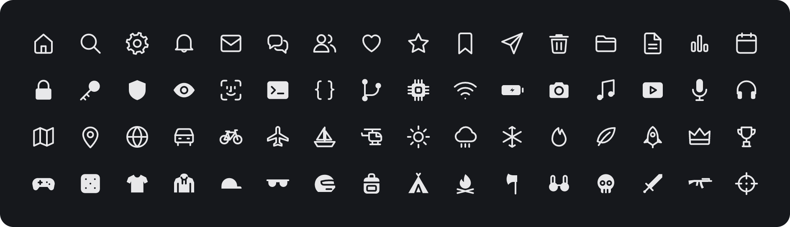

# Miralabs Icônes

[](https://www.npmjs.com/package/@miralabs-tech/icones)
[](https://www.npmjs.com/package/@miralabs-tech/icones)
[](https://github.com/miralabs-tech/miralabs-icones/actions/workflows/ci.yml)
[](https://github.com/miralabs-tech/miralabs-icones/releases)
[](https://miralabs-tech.github.io/miralabs-icones/docs/)
[](https://www.typescriptlang.org/)
[](./native/README.md)
[](./LICENSE)

> Hand-drawn symbols on a 24 grid, described once in layers — six weights, outline and fill, mono and hierarchical, for the web and for native code.

📖 English · [Français](./README.fr.md)

[Explorer](https://miralabs-tech.github.io/miralabs-icones/docs/) · [Quickstart](#-quickstart) · [Collections](#-collections) · [Native](./native/README.md) · [Contributing](./CONTRIBUTING.md)

<p align="center"></p>

---

## 🧠 What is it?

**436 symbols in 25 collections**, each drawn by hand on a 24 × 24 grid (1.5 stroke in Regular, round caps and joins). Names follow the SF convention (`object.modifier`, e.g. `square.and.arrow.up`); no path is copied from another icon set, and no logo is included ([LICENSE-BRANDS](./LICENSE-BRANDS)).

A symbol is written **once, in layers**; every variant is derived at render time:

- **6 weights** — `thin`, `light`, `regular`, `medium`, `semibold`, `bold`, aligned with `font-weight` 200 → 700.
- **2 shapes** — `outline` and `fill` (the fill is cut from the same source, not redrawn).
- **2 tones** — `mono` and `hier` (hierarchical: secondary layers at 42 %).
- **Colour** is always `currentColor`; **size** is a token (`sm`, `md`, `lg`) or any CSS length.

Two engines read the same render IR, so they draw the same thing:

```
src/data.ts ──▶ IR (symbolOps) ──┬──▶ web engine  → SVG string / DOM / <mira-symbol>
 (layers)                         └──▶ C99 engine  → 8-bit coverage mask (FFI-friendly)
```

---

## 🚀 Quickstart

```js
import { trash } from "@miralabs-tech/icones";
import { symbolToString } from "@miralabs-tech/icones/render";

el.innerHTML = symbolToString(trash, { weight: "semibold", shape: "fill", size: "md", label: "Delete" });
```

```html
<script type="module" src="node_modules/@miralabs-tech/icones/dist/mira-symbol.all.js"></script>
<mira-symbol name="trash" weight="semibold" shape="fill" size="md" label="Delete"></mira-symbol>
```

---

## 📦 Install

```sh
bun add @miralabs-tech/icones
```

`dist/` is committed, so `github:miralabs-tech/miralabs-icones#v<version>` works as a dependency too, without a build step.

---

## ✨ Usage

| Target | Entry point | Notes |
| --- | --- | --- |
| Data, tree-shaken | `@miralabs-tech/icones` | one export per symbol (`squareAndArrowUp`, `_5g`) |
| Renderer (~1 kB) | `@miralabs-tech/icones/render` | `symbolToString`, `symbolToElement`, `symbolTree` |
| Web component | `@miralabs-tech/icones/mira-symbol` | `<mira-symbol>`, light DOM; register only what you use |
| Whole set | `@miralabs-tech/icones/mira-symbol.all` | registers every symbol |
| SVG sprites | `@miralabs-tech/icones/sprite/<weight>-<shape>.svg` | zero JS, `<use href="…#trash"/>` |
| Raw data | `symbols.json`, `ir.json`, `metadata.json` | for non-JS engines, search, design tools |
| Frameworks | `adapters/{react,vue,svelte,angular}` | ~30 lines each, no duplicated SVG |
| Native | [`native/`](./native/README.md) | single C99 header, any language through FFI |

```html
<svg style="inline-size:var(--mira-icon-size-md);block-size:var(--mira-icon-size-md)">
  <use href="/icons/sprite/semibold-fill.svg#trash"/>
</svg>
```

```tsx
import { Symbol } from "@miralabs-tech/icones/adapters/react/Symbol.tsx";
import { magnifyingglass } from "@miralabs-tech/icones";

<Symbol symbol={magnifyingglass} weight="medium" tone="hier" label="Search" />
```

Symbols marked `rtl` (arrows, lists…) are mirrored when the document is right-to-left.

---

## 📚 Collections

| Collection | Symbols | Collection | Symbols |
| --- | ---: | --- | ---: |
| Navigation | 16 | Security & accessibility | 15 |
| Arrows | 27 | Settings | 8 |
| Actions | 25 | Status | 9 |
| Text & layout | 20 | Media | 20 |
| Files & data | 21 | Weather | 12 |
| Communication | 15 | Objects | 15 |
| Gestures & emotions | 8 | Clothing & accessories | 36 |
| People & accounts | 6 | Weapons | 18 |
| Commerce & payment | 15 | Survival | 14 |
| Devices & system | 28 | Shapes | 14 |
| Maps & places | 17 | Game controller | 32 |
| Time & calendar | 8 | Brand evocations | 15 |
| Development | 22 | | |

Search by name or by French tag in the [explorer](https://miralabs-tech.github.io/miralabs-icones/docs/).

---

## 📥 Release artifacts

Each `v*` tag attaches what the npm package leaves out ([release.yml](./.github/workflows/release.yml)):

| Archive | Content |
| --- | --- |
| `mira-icones-svg-<version>.zip` | `svg/<weight>/<shape>/<name>.svg` — 12 × 436 files |
| `mira-icones-font-<version>.zip` | `mira-symbols.ttf`, `.woff2`, `.css`, `codepoints.json` |
| `mira-icones-sprite-<version>.zip` | the 12 `<use>` sprites |
| `mira-icones-metadata-<version>.zip` | `metadata.json`, `symbols.json`, `ir.json` |

---

## 🔖 Versioning

Semver from the consumer's side: a new symbol is a **minor**, a corrected path is a **patch**, a renamed or removed symbol is a **major**.

---

## 🛠️ Contributing

Layers, drawing rules, build outputs and commands are in [CONTRIBUTING.md](./CONTRIBUTING.md).

```sh
bun install
bun run dev      # explorer with live rebuild
bun test         # unit + geometry audit (~1 s)
```

---

## 📜 License

Drawings, code and data: [MIT](./LICENSE). Third-party brands are never included — see [LICENSE-BRANDS](./LICENSE-BRANDS). `native/vendor/nanosvg*`: zlib.
